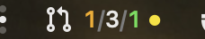
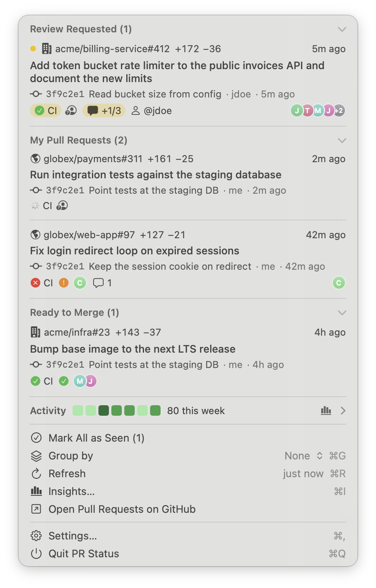
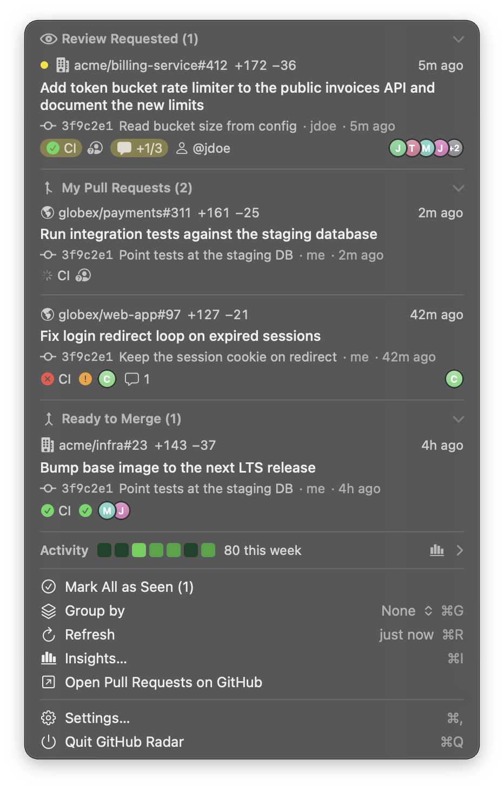
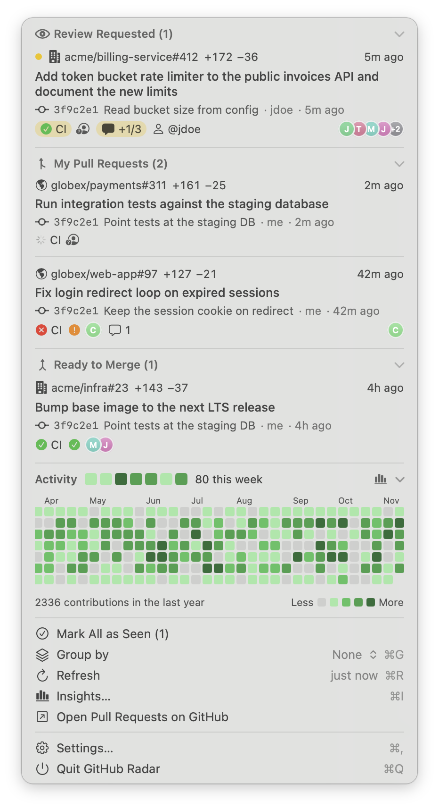
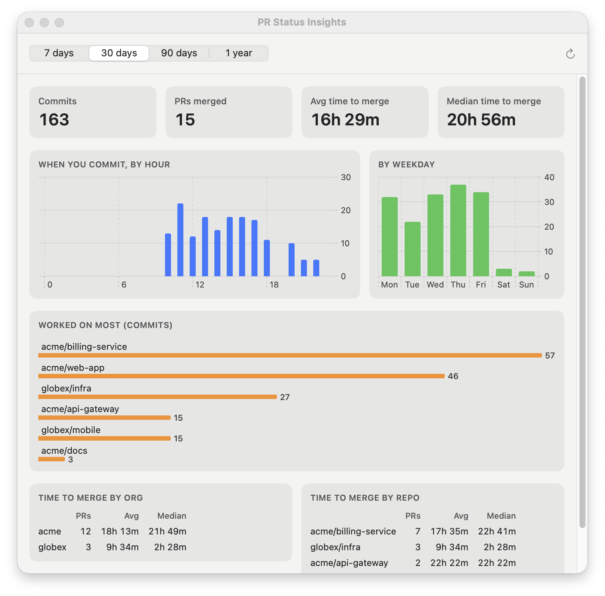

# GitHub Radar

Your GitHub pull requests in the macOS menu bar: what waits for your review, how your own PRs are doing, and what is ready to merge.

<p>
  
</p>

<p>
  
  
</p>

All screenshots use made-up demo data (`--demo`).

## What it shows

- **Menu bar:** `to review / yours / ready to merge`, and a dot colored by the most urgent news: red (your PR needs a fix), yellow (CI runs or a review waits for you), blue (new comments), green (approved or ready).
- **Cards:** repo and number, title, size (`+added −removed`), the latest commit, CI, reviews, comments and participants. A soft yellow mark shows what changed since you last opened the PR.
- **Hover for details:** CI checks with durations, who approved or asked for changes, comments with their threads, the latest commits, everyone on the PR. Every name, comment, commit and check is a link to its exact place on GitHub.
- **Activity:** your last 7 days, and a click opens the year's contribution calendar.



- **Insights:** when you commit (by hour and weekday), what you worked on most, and time to merge per org and repo.



- **Your layout:** drag the card elements onto lines in Settings, give orgs an alias or icon, hide or dismiss PRs, group by org or repo.
- **Keyboard:** ⌥⌘P opens the dropdown from any app. In it: ↑ ↓ ↩, ← → collapse sections, H hide, M dismiss, C copy link, ⌘G group, ⌘I insights.

## Install

Needs macOS 14 or later on Apple silicon.

1. Download `GitHubRadar-macos-arm64.zip` from the [latest release](https://github.com/danylkaaa/github-radar/releases/latest).
2. Unzip it and move `GitHub Radar.app` to `/Applications`.
3. The app is not notarized by Apple, so remove the download mark once:

   ```sh
   xattr -dr com.apple.quarantine "/Applications/GitHub Radar.app"
   ```

4. Open GitHub Radar. The icon appears in the menu bar.

**GitHub access:** the app uses the token of the [GitHub CLI](https://cli.github.com) (`gh auth login`). Without `gh`, paste a token with the `repo` scope in Settings → General → GitHub; it is stored in the macOS Keychain. The app talks only to `api.github.com`.

To start it with your Mac, turn on Settings → General → Launch at login.

## Build from source

Needs Xcode 16 or the Command Line Tools. Nothing else to install:

```sh
./radar build        # build app/.build/GitHub Radar.app
./radar run          # build and start from app/.build
./radar demo         # start with made-up data
./radar install      # build, copy to ~/Applications and start
./radar distribute   # build dist/GitHubRadar-macos-arm64.zip
./radar open         # open the package in Xcode
```

If you have [Task](https://taskfile.dev), the same steps are in `Taskfile.yml` (`task app:run` and so on).

## Layout

- `app/Sources/PRCore`: GitHub queries, the PR model, "new activity" and ready-to-merge rules, card layout, insights math.
- `app/Sources/GitHubRadar`: the app: menu bar item, dropdown, settings, insights window.
- `radar` (and `Taskfile.yml` for [Task](https://taskfile.dev)): build tasks. With only the Command Line Tools they build against the macOS 26.5 SDK, because the macOS 27 SDK needs Xcode for SwiftUI macros.
